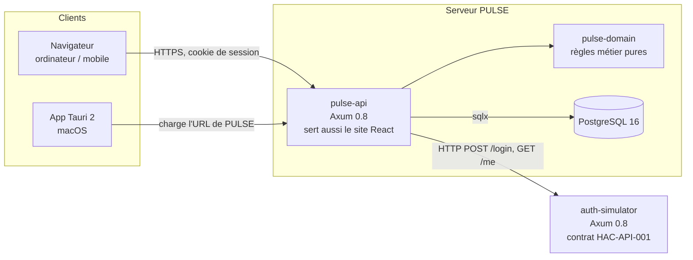

# Architecture

## Contexte : le SI existant de HealthAI Coach

PULSE V1 n'arrive pas sur un terrain vierge (HAC-TECH-001 §2). Ce qui existait avant la Squad, et que PULSE ne touche pas :

```mermaid
flowchart LR
  subgraph SI historique HealthAI Coach, hors périmètre
    WEB[Application web]
    MOB[Application mobile]
    CORE[Socle Java / Spring]
    HDB[(PostgreSQL historique)]
    AUTH[Service central d'authentification<br/>contrat HAC-API-001]
  end
  subgraph Construit par la Squad
    PULSE[PULSE V1<br/>pulse-api + site React]
    PDB[(Base PULSE V1)]
    SIM[auth-simulator<br/>remplace AUTH en dev et en recette]
  end
  WEB --> CORE
  MOB --> CORE
  CORE --> HDB
  CORE --> AUTH
  PULSE --> PDB
  PULSE -- HTTP, contrat HAC-API-001 --> SIM
  PULSE -. en production HealthAI, même contrat .-> AUTH
```

- PULSE est un composant **à côté** du socle Java : il ne le modifie pas et ne suppose pas sa disparition (TECH §3.2, §4.1).
- PULSE n'accède jamais à la base historique ni aux données internes d'un autre composant (TECH §3.3, §4.3) : sa base est la sienne.
- La Squad n'a aucun accès au service d'authentification réel : le simulateur le remplace en développement et en recette (TECH §3.4, API §1).

## Vue d'ensemble



- **Monolithe modulaire** : un seul serveur PULSE, découpé en modules par domaine. Le simulateur d'auth est un **service séparé**, imposé par le CDC.
- **Même origine** : `pulse-api` sert le site React compilé **et** l'API sous `/api/v1`. Le navigateur et l'app Tauri ne parlent qu'à cette adresse, donc le cookie de session fonctionne partout, sans CORS.
- **L'app Tauri** est une fenêtre qui charge l'URL de PULSE (locale ou en ligne). Elle n'a aucune commande Rust côté app et aucune logique métier.

## Remplacer le simulateur par le service réel

Question attendue du jury (TECH §8). Si HealthAI Coach branche son vrai service :

| Change | Ne change pas |
|---|---|
| `AUTH_SERVICE_URL` : l'URL HTTPS du service réel, **sans** le préfixe logique `/api/v1/auth`, que `auth_client` ajoute lui-même (API §2) | Le code métier (`pulse-domain`) et les routes : « le remplacement du simulateur par un service conforme au même contrat ne nécessiterait pas de réécrire la logique métier de PULSE » (API §11) |
| Le simulateur, sa route `/__control` et `AUTH_SIM_CONTROL_TOKEN` ne sont plus déployés | `auth_client`, seul point de contact avec le service (ADR-12) |
| La démonstration du 503 se fait autrement (coupure réseau, délai dépassé) | Les tests de contrat, qui restent la référence du comportement attendu |

Point ouvert : le service réel peut renvoyer d'autres rôles ou statuts que ceux de la V1 (Q5.7).

## Organisation du dépôt

```
pulse/
├── Cargo.toml              # workspace : crates/* (apps/desktop exclu des membres par défaut)
├── rust-toolchain.toml     # version Rust figée
├── Makefile                # make dev, make test, make seed, make auth-down…
├── crates/
│   ├── pulse-domain/       # entités, états, règles, validation. Aucune dépendance web ni base.
│   ├── pulse-api/          # Axum : routes, session, droits, accès base, client auth, OpenAPI
│   └── auth-simulator/     # Axum : /api/v1/auth/login, /api/v1/auth/me
├── apps/
│   ├── web/                # React 19 + Vite + TypeScript
│   └── desktop/            # Tauri 2 (src-tauri), charge PULSE_URL
├── data/hac-data-001/      # jeu de données converti en JSON (versionné)
├── migrations/             # migrations SQL (sqlx)
├── e2e/                    # tests Playwright (REC-01…13) + axe
└── spec/                   # ce dossier
```

## Modules de `pulse-api`

| Module | Rôle |
|---|---|
| `config` | Lit la configuration depuis les variables d'environnement, une seule fois au démarrage |
| `auth_client` | **Seul endroit qui appelle le service d'auth.** Délai maximal, validation de la réponse, traduction des erreurs |
| `session` | Cookie de session, extracteurs `CurrentUser` et `RequireRole<Admin>`, vérification `/me` à chaque requête |
| `routes::{auth, preferences, goals, challenges, progress, admin}` | Une route = valider l'entrée → appeler le domaine → enregistrer → répondre |
| `repo::{…}` | Requêtes SQL. Chaque requête de l'espace personnel filtre sur `user_id` |
| `error` | `AppError` → `{ code, message, details? }` + statut HTTP |
| `openapi` | Description utoipa, exportée dans `spec/api/pulse.openapi.yaml` |

`pulse-domain` contient les types (`Goal`, `GoalStatus`…), les transitions d'état et la validation. Il n'a ni E/S, ni async, ni dépendance à sqlx ou Axum, et se teste sans base.

## Flux d'une requête protégée

1. Le navigateur envoie le cookie `pulse_session`, qui contient le jeton opaque du service d'auth et n'est jamais lisible par JavaScript.
2. L'extracteur `CurrentUser` appelle `GET /api/v1/auth/me` avec ce jeton (à chaque requête, sans cache).
   - 401 → `SESSION_EXPIRED` ;
   - 403 → `ACCOUNT_DISABLED` ;
   - 503, délai dépassé ou réponse invalide → `AUTH_UNAVAILABLE`.
3. `RequireRole` vérifie le rôle ; un mauvais rôle donne **403** `FORBIDDEN`.
4. La route appelle le domaine avec le `user_id` issu de `/me`, jamais de la requête.
5. Une ressource qui appartient à un autre utilisateur donne **404** `NOT_FOUND`.

## Configuration

| Variable | Service | Exemple local |
|---|---|---|
| `DATABASE_URL` | api | `postgres://localhost/pulse` |
| `AUTH_SERVICE_URL` | api | `http://localhost:8081` |
| `AUTH_TIMEOUT_MS` | api | `3000` |
| `ALLOWED_ORIGINS` | api | `http://localhost:8080,http://localhost:5173` (origines acceptées sur les écritures ; en ligne : l'URL Railway seule) |
| `LOGIN_RATE_LIMIT_PER_MIN` | api | `5` (les E2E le montent à `1000`) |
| `TRUST_PROXY` | api | `false` en local, `true` sur Railway (IP client lue dans `X-Forwarded-For`) |
| `COOKIE_SECURE` | api | `false` en local, `true` en ligne |
| `WEB_DIST_DIR` | api | `apps/web/dist` |
| `PORT` | api, simulateur | `8080`, `8081` |
| `AUTH_SIM_UNAVAILABLE` | simulateur | `false` |
| `AUTH_SIM_CONTROL_TOKEN` | simulateur | secret, uniquement dans `.env` ou sur Railway |
| `AUTH_SIM_TOKEN_TTL` | simulateur | `3600` |
| `RUST_LOG` | tous | `info` |
| `PULSE_URL` | desktop | `http://localhost:5173` en dev, l'URL Railway en ligne |

En développement, Vite (port 5173) redirige `/api` vers `:8080`, ce qui garde la même origine et le cookie.

## Choix de bibliothèques

| Besoin | Choix |
|---|---|
| HTTP | `axum` 0.8, `tower-http` (en-têtes, limite de taille, fichiers statiques, trace), `tower_governor` (limite de débit) |
| Base | `sqlx` 0.8 (postgres, runtime tokio), requêtes vérifiées **à l'exécution** (`query_as`), migrations `sqlx::migrate!` |
| Client auth | `reqwest` (timeout explicite) |
| Sérialisation | `serde` (`rename_all = "camelCase"`, énumérations en `SCREAMING_SNAKE_CASE`) |
| Hachage | `argon2` (simulateur) |
| Journaux | `tracing`, `tracing-subscriber` (JSON) |
| OpenAPI | `utoipa` + `utoipa-axum` |
| Front | React 19, React Router 7, TanStack Query, `openapi-typescript` + `openapi-fetch` (types générés depuis l'OpenAPI) |
| Desktop | Tauri 2.12 |
| Tests | `cargo test`, `#[sqlx::test]`, Playwright + `@axe-core/playwright` |
