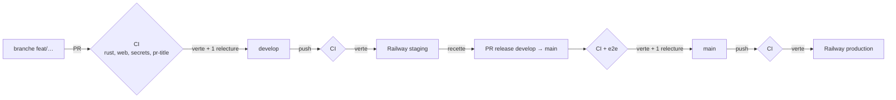

# CI, protection des branches et déploiement

Responsables : **Maxime** (CI, Railway, Neon), **Mael** (réglages GitHub : lui seul est admin du dépôt). Répond au CDC §5.2 et §5.6. Décisions : ADR-28 à ADR-32. Le workflow humain (branches, PR, releases, Trello) est dans [workflow.md](workflow.md).

Faits vérifiés le 2026-11-25 (dépôt GitHub, docs Railway et GitHub). Les points non confirmés sont signalés.

## Périmètre

| On fait (V1) | On ne fait pas (CDC §6, trajectoire V3) |
|---|---|
| Des vérifications automatiques **bloquantes** sur chaque PR (CDC §5.6) | Un pipeline de mise en production écrit à la main |
| `main` et `develop` protégées techniquement (CDC §5.2) | Des images Docker versionnées promues d'un environnement à l'autre |
| Railway déploie **lui-même** depuis GitHub, une fois la CI verte | Des environnements par PR, de l'infrastructure versionnée, de la supervision |

HAC-TECH-001 §5 dit que « la construction d'un pipeline CI/CD de mise en production » ne relève pas de V1, le CDC §6 exclut « un pipeline CI/CD complet de mise en production », et l'industrialisation de la livraison vers la préproduction est réservée à V3 (CDC §1.2 et §3). À l'inverse, HAC-TECH-001 §5 confie à la Squad « l'organisation du code, de l'environnement et du dépôt GIT », et HAC-API-001 §1 parle d'« environnements de développement et de recette » : c'est ce que couvrent `develop` et `staging`. Enfin, HAC-ACC-001 §13 ne fait **pas** d'un « pipeline CI/CD de production » ni d'une « stratégie industrielle complète de tests » des critères d'acceptation : ce qui suit est un outil de l'équipe, pas un livrable, et doit rester léger.

**Vocabulaire** : au sens du dossier, nos deux environnements en ligne sont des **environnements de recette**. HAC-ACC-001 (ACC-SEC-02) n'autorise les mots de passe de démo qu'« en développement et en recette ». `production` désigne ici la **version livrée** de PULSE V1, celle de la revue de version, jamais une production HealthAI : aucun vrai utilisateur, aucune donnée réelle. On s'arrête donc à **CI + déploiement natif de Railway**, et ce qui va au-delà part en recommandations V3 dans L7 (voir la fin de ce fichier).

## Vue d'ensemble

La CI ne déploie rien et ne détient aucun jeton Railway : Railway lit GitHub et attend que la CI du commit soit verte (« Wait for CI »).

## CI : GitHub Actions

Trois workflows dans `.github/workflows/` :

| Workflow | Déclencheurs | Rôle |
|---|---|---|
| `ci.yml` | `pull_request` vers `develop` ou `main`, `push` sur `develop` et `main` | Vérifications du code. Le `push` est indispensable : sans lui, « Wait for CI » de Railway n'a rien à attendre |
| `pr-title.yml` | `pull_request` (ouverture, modification du titre, nouveau commit) | Titre au format Angular ([workflow.md](workflow.md) → Commits) |
| `release-please.yml` | `push` sur `main` | PR de release, tag et Release GitHub (voir Release) |

- **Droits** : `permissions: contents: read` par défaut, `pull-requests: read` pour gitleaks, aucun droit pour `pr-title`. Pas de `pull_request_target`. Le seul secret est la clé privée de la GitHub App de release (voir Release), lue uniquement par `release-please.yml` sur `main`, jamais exposée aux PR.
- **Concurrence** : `group: ci-${{ github.ref }}`, annulation des exécutions précédentes **seulement pour les PR** (une exécution annulée sur `develop` ou `main` bloquerait le déploiement de ce commit).
- **Durée** : `timeout-minutes` sur chaque job ; objectif moins de 10 min pour une PR, grâce au cache Rust.
- La CI lance **les mêmes commandes** que `make check` sur les postes ([testing.md](testing.md)).
- **Activation progressive** : un job `detect` regarde si `Cargo.toml` (workspace Rust) et `e2e/playwright.config.ts` existent. Tant qu'ils n'existent pas, `rust` et `e2e` sont **sautés**, et GitHub compte un job sauté comme réussi pour un check requis. Ils s'activent seuls dès que le socle Rust et Playwright arrivent dans `develop`, sans retoucher la CI ni les rulesets.

| Job | Quand | Contenu | Check requis sur |
|---|---|---|---|
| `rust` | dès que `Cargo.toml` existe | `cargo fmt --all --check`, `cargo clippy --workspace --all-targets -- -D warnings`, `cargo test --workspace` avec un service `postgres:16`, `cargo deny check` (dès que `deny.toml` existe), contrôle de l'OpenAPI généré | `develop`, `main` |
| `web` | toujours | `pnpm install --frozen-lockfile`, puis dans `apps/web` : `lint` et `typecheck` s'ils existent, `build`. Passe sur le front V0 aujourd'hui, et sur le front V1 ensuite | `develop`, `main` |
| `secrets` | toujours | gitleaks sur tout l'historique (`fetch-depth: 0`). Aucune fuite trouvée le 2026-11-25, donc pas de liste d'exceptions | `develop`, `main` |
| `pr-title` | PR | Voir [workflow.md](workflow.md) → Commits | `develop`, `main` |
| `e2e` | PR vers `main`, dès que Playwright existe, sauf PR de release-please | `make e2e` : compilation, stack complète, Playwright (Chromium bureau et mobile 390 px) et axe. Rapport en artefact pendant 7 jours si échec | `main` |

Pourquoi `e2e` seulement vers `main` : c'est le job le plus lent (compilation release + navigateur). Il protège la production sans ralentir chaque PR ; les E2E restent lançables en local à tout moment. La PR de release-please ne touche que le changelog et la version : on n'y relance pas les E2E.

La V0 TypeScript n'a plus de tests en CI (`apps/api` est voué à disparaître) ; seul son front passe encore dans `web`.

**Contrôle de l'OpenAPI** : `spec/api/pulse.openapi.yaml` est généré par utoipa (ADR-07) avec `pulse-api openapi`, et versionné. Si le code change l'API sans que le fichier régénéré soit commité, `rust` échoue. `endpoints.md` décrit l'intention ; en cas d'écart, c'est le code + l'OpenAPI généré qui disent ce qui tourne, et on corrige l'un ou l'autre dans la même PR.

**Actions utilisées** (versions majeures en vigueur au 2026-11-25, toutes en Node 24) :

| Action | Version |
|---|---|
| `actions/checkout` | `v7` |
| `actions-rust-lang/setup-rust-toolchain` | `v2` : lit `rust-toolchain.toml`, met en cache `target/` |
| `EmbarkStudios/cargo-deny-action` | `v2` |
| `pnpm/action-setup` + `actions/setup-node` | `v6` + `v7` avec `cache: pnpm` |
| `googleapis/release-please-action` + `actions/create-github-app-token` | `v5.0.0` + `v3.4.0`, **épinglées par SHA** : c'est le seul workflow qui manipule une clé et un jeton en écriture |
| `gitleaks/gitleaks-action` | `v3` (gratuit pour un dépôt personnel ; une licence gratuite serait demandée si le dépôt passait dans une organisation) |
| `actions/upload-artifact` | `v7` |

Les navigateurs Playwright ne sont pas mis en cache (déconseillé par Playwright) : `pnpm exec playwright install --with-deps chromium`.

Les actions des workflows en lecture seule sont épinglées sur leur version majeure ; une action qui reçoit un secret ou des droits en écriture est épinglée par SHA de commit, et on monte sa version à la main en relisant le changelog.

**Règles** :
- `develop` rouge = on répare avant toute autre fusion.
- Pas de `continue-on-error`, pas de relance automatique d'un test instable ([testing.md](testing.md) → Tests instables).
- Alertes et correctifs de sécurité **Dependabot** activés ; pas de PR automatiques de montée de version pendant le projet (trop de bruit pour 21 h).

## Protection des branches

Le dépôt `mael-bourdin/pulse` est **public** et appartient à un compte personnel : les rulesets et les minutes Actions sont gratuits. S'il redevenait privé sur un compte Free, on perdrait les rulesets. Les collaborateurs ont le droit Write, Mael est le seul admin : c'est lui qui configure.

Un ruleset par branche (Settings → Rules → Rulesets) :

| Règle | `main` | `develop` |
|---|---|---|
| Restrict deletions | oui | oui |
| Block force pushes | oui | oui |
| Require a pull request | oui, **1 approbation** | oui, **1 approbation** |
| Dismiss stale approvals on new push | oui | oui |
| Require conversation resolution | oui | oui |
| Allowed merge methods | **Merge** uniquement | **Squash** et **Merge** (merge réservé aux reports `main` → `develop`, vérifié par le relecteur) |
| Require status checks | `rust`, `web`, `secrets`, `pr-title`, `e2e` | `rust`, `web`, `secrets`, `pr-title` |
| Require branches to be up to date | oui | non (évite les rebases en chaîne à 4) |
| Bypass list | **vide**, admin compris | **vide**, admin compris |

Si l'option « Allowed merge methods » n'apparaît pas dans le ruleset, on autorise squash et merge dans les réglages du dépôt, et c'est le relecteur qui vérifie la méthode.

Réglages du dépôt (Settings → General) :
- Branche par défaut : `develop`.
- Fusions : merge commit et squash autorisés, rebase désactivé ; message de squash par défaut = titre de la PR.
- « Automatically delete head branches » activé.
- Actions : `GITHUB_TOKEN` en lecture seule par défaut ; Actions ne peut ni créer ni approuver de PR.

Les checks n'apparaissent dans la liste des rulesets qu'après avoir tourné une fois : on crée les rulesets **après** la première exécution du nouveau `ci.yml` (la PR qui l'ajoute suffit).

## Release : release-please

[release-please](https://github.com/googleapis/release-please) lit les commits Angular arrivés sur `main`, en déduit la prochaine version (SemVer) et tient `CHANGELOG.md`. Le cycle complet est dans [workflow.md](workflow.md) → Release.

- **Configuration** : `release-please-config.json` (type `simple`, un seul paquet à la racine, sections du changelog en français, `bootstrap-sha` = dernier commit de la V0 pour ne pas reprendre son historique) et `.release-please-manifest.json` (version courante, `0.0.0` au départ).
- **Version dans le code** : dès que le workspace Rust existe, on ajoute dans `extra-files` le fichier `Cargo.toml` (`$.workspace.package.version`, type `toml`) et `apps/web/package.json` (`$.version`, type `json`). `/health` affiche alors la version publiée.
- **Jeton : une GitHub App, pas un jeton personnel.** Une PR ouverte avec le `GITHUB_TOKEN` ne déclenche **aucun** workflow : la PR de release n'aurait jamais ses checks requis et resterait bloquée par le ruleset de `main`. Le workflow demande donc à une petite GitHub App, `pulse-release-bot`, un jeton valable **1 heure** et limité à ce dépôt (`actions/create-github-app-token`, épinglée par SHA). Par rapport à un jeton personnel : il n'appartient à personne, n'expire pas tous les 90 jours, et la PR de release est ouverte par le bot, donc n'importe quel membre peut l'approuver.
  - Création (Maxime), avec ce lien qui préremplit tout : <https://github.com/settings/apps/new?name=pulse-release-bot&description=release-please%20pour%20mael-bourdin%2Fpulse&url=https%3A%2F%2Fgithub.com%2Fmael-bourdin%2Fpulse&public=true&webhook_active=false&contents=write&pull_requests=write&issues=write>. *Public* veut seulement dire « installable sur un autre compte », ici celui de Mael. Puis générer une clé privée et noter le *Client ID*.
  - Installation (Mael, seul à pouvoir installer une app sur son compte) : sur `mael-bourdin/pulse` uniquement.
  - Configuration (Maxime, un collaborateur Write peut le faire) : variable `RELEASE_APP_CLIENT_ID` et secret `RELEASE_APP_PRIVATE_KEY` dans Settings → Secrets and variables → Actions. Supprimer ensuite le fichier `.pem` du poste.
  - Tant que l'app n'est pas configurée, le workflow retombe sur `GITHUB_TOKEN` : la PR de release est créée, mais il faut la fermer puis la rouvrir à la main pour lancer la CI. Ce repli marche aussi si la clé est révoquée.
- release-please ne crée de release que s'il y a au moins un `feat`, `fix`, `perf` ou `revert` depuis la précédente : une promotion qui ne contient que des specs ne produit pas de version.
- **Forcer une version** (`v1.0.0` pour la soutenance) : écrire `Release-As: 1.0.0` dans le **corps du merge commit** de la PR de promotion (GitHub permet de l'éditer au moment de fusionner). Rien à changer dans la configuration.
- **Corriger une note de version** après coup : ajouter un bloc `BEGIN_COMMIT_OVERRIDE` … `END_COMMIT_OVERRIDE` dans la description de la PR fusionnée. Ça ne marche que pour une PR fusionnée en squash, donc pour les PR vers `develop`, pas pour la promotion.
- **Pas de PR de release ?** Vérifier qu'une ancienne PR ne porte plus l'étiquette `autorelease: pending` (README de release-please, section Troubleshooting), puis relancer le workflow.
- Le jour où `Cargo.toml` passe dans `extra-files`, vérifier que `Cargo.lock` suit (sinon `cargo build --locked` échoue après une release).

## Déploiement : Railway + Neon (gratuit)

Objectif : **0 €**. Les deux services Rust tournent sur le plan **Free** de Railway, PostgreSQL sur le plan **Free** de Neon. Voir Plan et coût pour les limites et les replis.

### Projet

Projet Railway **`pulse`** créé le 2026-11-25 (ID `915d0dc6-b726-4e97-b66a-28647d0f0eaa`), environnements `production` et `staging`, **aucun service pour l'instant**. Il est dans l'espace de Maxime, en essai jusqu'au 2026-12-25 environ, puis sur le plan Free (on ne passe pas en payant). Base : une organisation Neon `pulse` avec deux projets, `pulse-production` et `pulse-staging`, en PostgreSQL 16, où les quatre membres sont invités.

Les réglages Railway se font dans le **tableau de bord**, et **ce fichier en est la référence** : un réglage change d'abord ici, par PR. Les fichiers `railway.json` / `railway.toml` ne sont pas utilisés : Railway les a dépréciés et ne les lira plus à partir du 2026-12-01 (docs.railway.com/config-as-code/reference). Leur remplaçant, l'infrastructure as code (`.railway/railway.ts`), demande une commande ou une action pour s'appliquer : hors périmètre V1.

### Environnements

| | `production` | `staging` |
|---|---|---|
| Branche qui déclenche le déploiement | `main` | `develop` |
| Usage | Démo du jury (L4), soutenance | Recette carte par carte, démos de fin de sprint |
| Données | Seed avant chaque démo, sinon on n'y touche pas | Seed à volonté |
| Mise en veille | Forcée par le plan Free (10 min sans trafic sortant) : on chauffe avant la démo | idem |
| Domaine | `*.up.railway.app` généré, sur `pulse-api` seulement, noté dans le README | idem |
| `AUTH_SIM_CONTROL_TOKEN` | Le sien | Le sien, différent |

### Services (identiques dans les deux environnements)

| Service | Source | Build | Réseau | Chemins surveillés (watch paths) |
|---|---|---|---|---|
| `pulse-api` | GitHub `mael-bourdin/pulse`, racine du dépôt | Railpack, voir ci-dessous. Pré-déploiement : `pulse-api migrate`. Healthcheck : `/health`, délai 60 s | Domaine public HTTPS | `/crates/pulse-api/**`, `/crates/pulse-domain/**`, `/apps/web/**`, `/migrations/**`, `/data/**`, `/Cargo.toml`, `/Cargo.lock`, `/rust-toolchain.toml`, `/pnpm-lock.yaml` |
| `auth-simulator` | idem | Railpack, `RAILPACK_CARGO_WORKSPACE=auth-simulator` | **Privé uniquement**, aucun domaine public | `/crates/auth-simulator/**`, `/Cargo.toml`, `/Cargo.lock`, `/rust-toolchain.toml` |
| Base | **Neon**, hors Railway : projet `pulse-production` ou `pulse-staging`, PostgreSQL 16 | — | Internet, TLS obligatoire, mot de passe fort | — |

Les chemins surveillés évitent de redéployer quand seule la spec ou la doc change.

**Build de `pulse-api`** : Railpack choisit le langage Rust et ne compile pas le front tout seul. Réglages à tester en S0, **pendant 30 minutes au plus** :
- `RAILPACK_CARGO_WORKSPACE=pulse-api` (sinon Railpack prend le premier binaire du workspace) ;
- `RAILPACK_PACKAGES="node@22 pnpm"` pour disposer de Node ;
- commande de build : `pnpm install --frozen-lockfile && pnpm --dir apps/web build && cargo build --release -p pulse-api`.

Railway ne documente pas officiellement cette combinaison. Si elle échoue dans le temps imparti, on ajoute `crates/pulse-api/Dockerfile` en plusieurs étapes (Node pour le front, Rust pour le binaire, image Debian slim pour l'exécution), utilisé **uniquement** par Railway. Personne n'installe Docker sur son poste : ADR-18 tient, et l'écart est consigné dans [decisions.md](decisions.md).

Rien ne se connecte à la base pendant la compilation : les requêtes sqlx sont vérifiées à l'exécution (ADR-13).

**Limite de 10 min du plan Free** : la compilation release d'Axum, sqlx et utoipa doit y tenir, cache Railpack aidant. Si elle dépasse, le repli est de construire l'image dans GitHub Actions et de la publier sur GHCR, que Railway déploie ; c'est un vrai pipeline de livraison (écart à TECH §5, à consigner), donc on ne le fait que si on y est obligé.

### Variables

Saisies par environnement. La syntaxe `${{service.VARIABLE}}` est une référence Railway, résolue au déploiement.

| Service | Variable | Valeur |
|---|---|---|
| `pulse-api` | `DATABASE_URL` | chaîne de connexion **directe** du projet Neon de l'environnement (sans `-pooler` : sqlx gère son propre pool, et les migrations exigent une connexion directe), avec `sslmode=require`. Variable scellée |
| | `AUTH_SERVICE_URL` | `http://${{auth-simulator.RAILWAY_PRIVATE_DOMAIN}}:${{auth-simulator.AUTH_SIM_PORT}}` |
| | `ALLOWED_ORIGINS` | `https://${{RAILWAY_PUBLIC_DOMAIN}}` |
| | `COOKIE_SECURE`, `TRUST_PROXY` | `true` |
| | `LOGIN_RATE_LIMIT_PER_MIN` | `5` |
| | `AUTH_TIMEOUT_MS` | `3000` |
| | `RUST_LOG` | `info` |
| | `PORT` | injectée par Railway, ne pas la définir |
| `auth-simulator` | `AUTH_SIM_PORT` | `8081` |
| | `AUTH_SIM_CONTROL_TOKEN` | secret aléatoire (`openssl rand -hex 32`), **variable scellée**, différent par environnement |
| | `AUTH_SIM_UNAVAILABLE` | `false` |
| | `AUTH_SIM_TOKEN_TTL` | `3600` |
| | `RUST_LOG` | `info` |

Les deux serveurs écoutent sur `[::]` (IPv4 et IPv6), comme le recommande le guide Axum de Railway pour le réseau privé.

Une variable scellée n'est plus lisible, ni dans l'interface, ni par `railway run`, et **n'est pas copiée** quand on duplique ou synchronise un environnement : il faut la ressaisir dans chaque environnement.

**Mise en veille** : Railway endort un service qui n'a plus de trafic **sortant** depuis 10 min. Une connexion ouverte vers Neon l'en empêcherait (et consommerait le crédit), donc le pool sqlx garde **0 connexion au repos** (`min_connections(0)`, `idle_timeout` de 60 s). Neon s'endort de lui-même après 5 min et se réveille en quelques centaines de millisecondes. Un appel de l'API réveille le simulateur par le réseau privé.

### Wait for CI

Activé sur `pulse-api` et `auth-simulator`, dans les deux environnements (réglages du service). Il faut que Mael accepte la mise à jour des permissions de l'application GitHub de Railway.

Comportement documenté par Railway : le déploiement reste en attente (`WAITING`) jusqu'à la fin des workflows GitHub Actions du commit. Un workflow en échec **annule** le déploiement ; un job sauté ne bloque pas. Au-delà de 2 h d'attente, le déploiement est abandonné.

### Migrations

- Lancées par la commande de pré-déploiement `pulse-api migrate`, avant la nouvelle version, sur la base Neon de l'environnement. Si elle échoue, le déploiement est annulé et l'ancienne version reste en ligne (ADR-31).
- Une migration fusionnée dans `develop` n'est **jamais** modifiée : sqlx vérifie leur somme de contrôle et refuserait de démarrer sur `staging` et `production`. On en ajoute une nouvelle.
- À partir de `v0.2.0`, migrations **additives** seulement (ajouter une table, une colonne nullable, un index). Pendant quelques secondes, l'ancienne version tourne sur le nouveau schéma, et le retour arrière Railway ne défait pas une migration.
- Noms : `migrations/<AAAAMMJJHHMM>_<sujet>.sql` (format sqlx), relus dans chaque PR de release.

### Healthcheck

- `GET /health` (hors `/api/v1`) répond `200 { "status": "ok", "version": "0.2.0", "commit": "<sha court>" }`. Le commit vient de `RAILWAY_GIT_COMMIT_SHA`, fournie par Railway (`local` sur un poste).
- Il exécute `SELECT 1` sur la base (503 si elle ne répond pas) mais **n'appelle jamais le service d'auth** : sinon, une démonstration du 503 bloquerait les déploiements.
- Railway ne bascule le trafic qu'une fois `/health` en 2xx ; sinon la nouvelle version est marquée en échec et l'ancienne continue de servir. Le healthcheck ne tourne qu'au déploiement : ce n'est pas de la supervision.

### Données

Le seed n'est **jamais** lancé automatiquement par un déploiement (il effacerait les données). On le lance à la main : au premier déploiement d'un environnement, avant une recette sur `staging`, et la veille de la démo sur `production` ([hosting.md](hosting.md) → Remise à zéro). Pas de sauvegarde : restaurer, c'est relancer le seed (ADR-32).

### Retour arrière

1. **Immédiat** : Railway → service → Deployments → ⋯ → Rollback. L'image et les variables précédentes reviennent sans recompiler. Possible tant que l'image est conservée : **24 h** sur Free et en essai ; au-delà, Railway recompile.
2. **Ensuite** : bouton « Revert » sur la PR fautive, en PR vers `main` (relue, CI verte), puis report dans `develop` comme un hotfix ([workflow.md](workflow.md) → Hotfix).

Un retour arrière ne défait pas les migrations : d'où la règle des migrations additives.

### Plan et coût

Règle d'équipe : **on ne paie rien**. Comparatif fait le 2026-11-25 (Railway, Neon, Render, Northflank, Fly.io, Koyeb, offres étudiantes, Oracle Always Free) : la combinaison Railway Free + Neon Free est la seule qui donne deux environnements, garde le simulateur privé et ne demande ni carte bancaire ni serveur à administrer.

| Contrainte du plan gratuit | Conséquence | Parade |
|---|---|---|
| Railway Free : 3 services et **1 volume** par projet | Pas de PostgreSQL Railway par environnement | Base sur **Neon Free** : un projet par environnement, 1 Go et 100 heures de calcul chacun, mise en veille après 5 min, sans limite de durée ni carte |
| Railway Free : mise en veille **forcée** | Premier appel lent, parfois une 502 au réveil | Pool sqlx à 0 connexion au repos ; **chauffe** 2 min avant chaque démo (ouvrir le site, se connecter une fois) |
| Railway Free : **1 $** de crédit par mois | Services arrêtés jusqu'au mois suivant si on le dépasse | Services endormis la plupart du temps ; surveiller l'usage chaque semaine |
| Railway Free : build de **10 min** | Le build Rust peut dépasser | Cache Railpack ; repli : image construite par la CI (voir Services) |
| Railway Free : **1 membre** par projet | Seul Maxime voit le tableau de bord et les journaux Railway | Statuts de déploiement visibles dans les PR GitHub ; Neon accepte des membres illimités, donc tout le monde peut lancer un seed |
| Railway Trial actuel : 5 $ ou 30 jours | Passe en Free vers le 2026-12-25 | Rien à faire, sauf vérifier le point suivant |

**Risque non levé** : Railway ne dit pas si la limite de 3 services compte les services du projet (`pulse-api` + `auth-simulator` = 2) ou leurs instances dans chaque environnement (2 × 2 = 4). Les docs ne le précisent pas, et la question est ouverte sur le forum Railway sans réponse. On le saura au passage en Free. Replis, dans l'ordre :
1. `production` reste sur Railway Free, `staging` passe sur **Render Free** (branche `develop`, option de déploiement « après les checks de CI », base Neon `pulse-staging`). Inconvénients : le simulateur de recette devient public (sa route `/__control` reste protégée par son secret) et un réveil prend environ 1 min.
2. Auto-hébergement sur **Oracle Cloud Always Free** (VM ARM) avec Dokploy : pas de mise en veille, mais carte bancaire exigée à l'inscription, 4 à 8 h de mise en place, de l'administration, et Oracle récupère les VM trop peu utilisées.

Sont exclus : Railway Hobby (payant), Render pour la base (PostgreSQL gratuit supprimé au bout de 30 jours), Supabase (projet en pause après 7 jours d'inactivité), Fly.io et Koyeb (carte exigée, trop peu de services gratuits), Heroku étudiant (carte exigée).

### Accès

Railway Free n'accepte qu'un membre par projet : le projet reste dans l'espace de Maxime, et c'est lui qui fait les réglages et la démonstration du 503 en ligne (Q14.2). Mael installe l'application GitHub de Railway sur `mael-bourdin/pulse`, ce que seul le propriétaire du dépôt peut faire. Les quatre membres sont invités dans l'organisation Neon.

## Mise en place (S0, environ 1 h 30)

GitHub, par Mael :
1. Après la fusion de cette spec, créer `develop` depuis `main` et en faire la branche par défaut.
2. Appliquer les réglages du dépôt (fusions, suppression des branches, droits d'Actions, Dependabot).

CI, par Maxime :

3. Fait dans la PR d'initialisation : `ci.yml`, `pr-title.yml`, `release-please.yml`. Reste à écrire `make check` et `make e2e` avec le socle Rust.
4. Une fois le workflow passé une fois, Mael crée les deux rulesets.

Railway et Neon, par Maxime (avec Mael pour GitHub) :

5. Mael installe l'application GitHub de Railway sur `mael-bourdin/pulse` et accepte ses permissions (« Wait for CI »). Maxime crée l'organisation Neon, les deux projets en PostgreSQL 16, et invite l'équipe.
6. Dès que le socle Rust est dans `develop` : dans `staging`, créer `auth-simulator` et `pulse-api` depuis le dépôt, branche `develop`, puis les variables, chemins surveillés, pré-déploiement, healthcheck, « Wait for CI » et le domaine public de `pulse-api`. Avant, il n'y a rien d'utile à déployer : la V0 TypeScript ne fait pas partie de la cible.
7. Seed de `staging`, puis vérifier : `/health`, connexion d'Alex, un 401, le 503 avec `make auth-down-remote ENV=staging`.
8. En S1 : même chose dans `production` avec la branche `main` (une synchronisation d'environnements recopie les services, mais garde la branche `develop` et perd les variables scellées : les corriger à la main). Noter les deux URL dans le README.

## Hors périmètre V1 : recommandations V3 (L7)

À présenter comme la suite logique, pas comme des manques :
- **Infrastructure as code** (`.railway/railway.ts`) appliquée par la CI, à la place des réglages saisis à la main.
- **Construire une fois, déployer partout** : aujourd'hui `production` recompile `main` au lieu de réutiliser ce qui a été testé sur `staging`. Le code source est identique (merge commit, `Cargo.lock`, `pnpm-lock.yaml` et `rust-toolchain.toml` figés) ; c'est un compromis acceptable pour V1.
- Environnements éphémères par PR, avec base jetable.
- E2E automatiques contre `staging` après chaque déploiement.
- Supervision et alertes (le healthcheck Railway ne surveille qu'au déploiement), sauvegardes de la base.
- App Tauri compilée, signée et publiée par la CI.
- File de fusion (merge queue), qui demande que le dépôt appartienne à une organisation.
