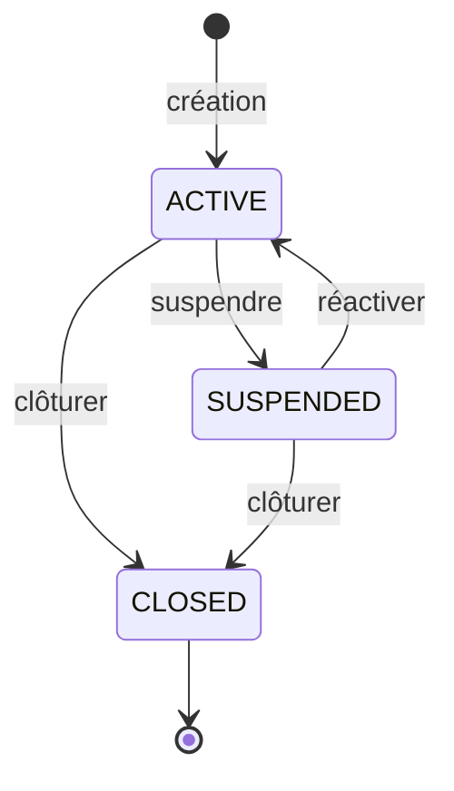

# F3 — Objectifs personnels

- **Responsable** : Maxime
- **User stories** : US-GOAL-01 à 04
- **Règles** : RG-GOAL-01 à 08
- **Décisions** : ADR-21

## Comportement

| Id | Exigence | Source |
|---|---|---|
| F3-R01 | La liste ne contient que les objectifs de l'utilisateur de la session (DATA pour Alex : goal-001, goal-002, goal-009) | RG-GOAL-01, ACC-GOAL-01 |
| F3-R02 | Création : `label` (1–120, espaces retirés), `category` (5 valeurs), `targetValue` (nombre > 0, ≤ 1 000 000), `unit` (liste fermée, F3-R11), `endDate` facultative (≥ date du jour de création si fournie ; `null` vaut absente) | RG-GOAL-02, ACC-GOAL-02 |
| F3-R03 | Un nouvel objectif est créé en **ACTIVE**, avec `currentValue = 0`, `startDate` = date du jour et `userId` = celui de la session | RG-GOAL-03, ACC-GOAL-03 |
| F3-R04 | Cible vide, nulle, négative ou non numérique → 400 `VALIDATION_ERROR` (`details` sur `targetValue`) ; aucun objectif créé | ACC-GOAL-04 |
| F3-R05 | Modification (`label`, `category`, `targetValue`, `unit`, `endDate`) seulement si **ACTIVE** ; sinon 409 `INVALID_STATE` « Seul un objectif actif peut être modifié. » | RG-GOAL-05, 07, ACC-GOAL-05 |
| F3-R06 | Progression : `currentValue` ≥ 0, seulement si **ACTIVE** ; sinon 409 `INVALID_STATE` « La progression d'un objectif suspendu ou clôturé ne peut pas être modifiée. ». Une valeur négative donne 400 | RG-GOAL-08, ACC-GOAL-08 |
| F3-R07 | Transitions selon le diagramme ; toute autre transition → 409 `INVALID_STATE`. Clôturer renseigne `endDate` = date du jour si elle était vide | RG-GOAL-05 à 07, ACC-GOAL-06, 07 |
| F3-R08 | Un objectif d'un autre utilisateur (consultation, modification, transition) → **404** `NOT_FOUND`, et rien n'est modifié | RG-GOAL-01, ACC-GOAL-09, ADR-09 |
| F3-R09 | Le pourcentage affiché vaut `min(100, arrondi(currentValue / targetValue × 100))`. Dépasser la cible est autorisé (goal-006 : 165/150) | — |
| F3-R10 | Modification de `endDate` : la règle « ≥ date du jour » ne s'applique **que si la valeur change**. Renvoyer la date enregistrée, même passée, est accepté : tous les objectifs de DATA ont une date de fin passée (goal-001 : 2026-03-31). `endDate: null` efface la date ; un champ `endDate` absent la laisse inchangée. Une nouvelle date antérieure à la date du jour → 400 `VALIDATION_ERROR` (`details` sur `endDate`) | RG-GOAL-05, ACC-GOAL-05 |
| F3-R11 | `unit` appartient à une **liste fermée**, la même pour l'API et l'interface : `pas/jour`, `min/jour`, `min/semaine`, `h/nuit`, `L/jour`, `séances/jour`, `séances/semaine`, `jours/semaine`, `portions/jour`. Ce sont toutes les unités des objectifs et des défis de DATA (feuilles 03 et 04), donc les objectifs existants restent modifiables. Comparaison exacte après retrait des espaces ; toute autre valeur → 400 `VALIDATION_ERROR` (`details` sur `unit`) | RG-GOAL-02, ACC-GOAL-02 |

Les règles de transition et de validation se trouvent dans `pulse-domain::goal` et sont testées unitairement. La liste des unités y est définie une seule fois et publiée comme `enum` dans l'OpenAPI ; l'interface la reprend depuis les types générés.

## Écrans

### `/objectifs` (UX p.7)
- Titre « Mes objectifs », bouton « + Nouvel objectif ».
- **Liste** des objectifs ACTIVE et SUSPENDED. Chaque carte contient :
  - le libellé, la catégorie et un badge d'état (Actif, Suspendu) ;
  - « 6 250 / 8 000 pas/jour » et une barre de progression (`role="progressbar"` avec sa valeur en pourcentage) ;
  - si ACTIVE : champ « Nouvelle valeur » + bouton « Mettre à jour », boutons « Modifier », « Suspendre » et « Clôturer » ;
  - si SUSPENDED : boutons « Réactiver » et « Clôturer ».
- **Section « Objectifs clôturés »** : cartes en lecture seule, badge « Clôturé ».
- **Panneau « Créer / modifier un objectif »** : libellé, catégorie, valeur cible, unité (liste de F3-R11, dans cet ordre), date de fin facultative ; boutons « Enregistrer » et « Annuler ». La mention « Les champs marqués * sont obligatoires. » est affichée.
  - En modification, le panneau est prérempli avec les valeurs enregistrées.
  - « Date de fin » n'a pas d'attribut `min` : une date passée déjà enregistrée doit pouvoir être renvoyée telle quelle (F3-R10). Vider le champ envoie `endDate: null`.

| État | Texte |
|---|---|
| Chargement | « Chargement de vos objectifs… » |
| Vide (aucun ACTIVE ni SUSPENDED) | **« Aucun objectif actif »** — « Fixez-vous un premier cap simple, par exemple quelques minutes de marche par jour. » + bouton « Créer un objectif » (UX p.11) |
| Créé | « Objectif créé. » |
| Modifié | « Objectif modifié. » |
| Progression enregistrée | « Progression mise à jour. » |
| Suspendu | « Objectif suspendu. » |
| Réactivé | « Objectif réactivé. » |
| Clôturé | « Objectif clôturé. » |
| Erreur | Message de l'API sous le champ concerné (validation) ou en alerte (409, 503) |

- **Confirmation** : « Clôturer » ouvre une confirmation dans la carte, sans boîte de dialogue du navigateur : « Clôturer définitivement cet objectif ? Il ne pourra plus être modifié. » avec « Oui, clôturer » et « Annuler ». « Suspendre » ne demande pas de confirmation, puisque l'action est réversible.
- **Accessibilité** :
  - le focus passe sur le titre du panneau à son ouverture ;
  - les erreurs sont reliées aux champs ;
  - après une transition, le focus revient sur la carte ;
  - le champ cible utilise `inputmode="decimal"`.

## API

| Action | Endpoint | Codes |
|---|---|---|
| Lister | `GET /api/v1/me/goals` | 200 |
| Créer | `POST /api/v1/me/goals` | 201, 400 |
| Modifier | `PATCH /api/v1/me/goals/{goalId}` | 200, 400, 404, 409 |
| Mettre à jour la progression | `PUT /api/v1/me/goals/{goalId}/progress` | 200, 400, 404, 409 |
| Suspendre, réactiver, clôturer | `POST /api/v1/me/goals/{goalId}/{suspend,reactivate,close}` | 200, 404, 409 |

Toutes ces routes peuvent aussi renvoyer 401, 403 et 503 (F1-R26, F1-R28).

## Critères d'acceptation

Cas de référence de DATA :

| Objectif | Utilisateur | Données | Sert à vérifier |
|---|---|---|---|
| goal-001 | Alex | ACTIVE, fin 2026-03-31 | Modification avec une date de fin passée inchangée (R10) |
| goal-004 | Samira | SUSPENDED | Modification et progression refusées, réactivation, clôture |
| goal-006 | Chloé | CLOSED, 165/150 | Toute écriture refusée, pourcentage plafonné à 100 % (R09) |

| Critère | Exigences | Vérification | Test |
|---|---|---|---|
| ACC-GOAL-01 | R01 | Intégration | `acc_goal_01_lister_ses_objectifs` |
| ACC-GOAL-02 / REC-07 | R02 | Intégration, E2E | `acc_goal_02_creer`, `rec_07` |
| ACC-GOAL-02 | R11 | Unitaire, intégration | `acc_goal_02_unite_hors_liste_refusee` ("km", "PAS/JOUR", "" → 400) |
| ACC-GOAL-03 | R03 | Intégration | `acc_goal_03_rattache_a_la_session` |
| ACC-GOAL-04 | R04 | Unitaire, intégration | `acc_goal_04_cible_non_positive_refusee` (0, -5, "", "abc") |
| ACC-GOAL-05 | R05 | Unitaire, intégration | `acc_goal_05_modifier_si_actif` (goal-001 → 200 ; goal-004 et goal-006 → 409) |
| ACC-GOAL-05 | R10 | Unitaire, intégration | `acc_goal_05_date_de_fin_passee_inchangee` (goal-001 renvoyé tel quel → 200 ; nouvelle date passée → 400 ; `null` → effacée ; absente → inchangée) |
| ACC-GOAL-06 | R07 | Unitaire, intégration | `acc_goal_06_suspendre` (goal-001 → SUSPENDED ; goal-004 réactivé → ACTIVE ; goal-006 → 409) |
| ACC-GOAL-07 | R07 | Unitaire, intégration | `acc_goal_07_cloturer` (goal-004 → CLOSED ; goal-006 → 409) |
| ACC-GOAL-08 / REC-07 | R06 | Unitaire, intégration, E2E | `acc_goal_08_progression` (goal-004 et goal-006 → 409) |
| ACC-GOAL-09 | R08 | Intégration | `acc_goal_09_objectif_d_autrui_404` |
| — | R09 | Unitaire | `f3_r09_pourcentage_plafonne` (goal-006 : 165/150 → 100 %) |

## Hors périmètre

- Historique de progression jour par jour.
- Rappels automatiques.
- Suppression d'un objectif.
