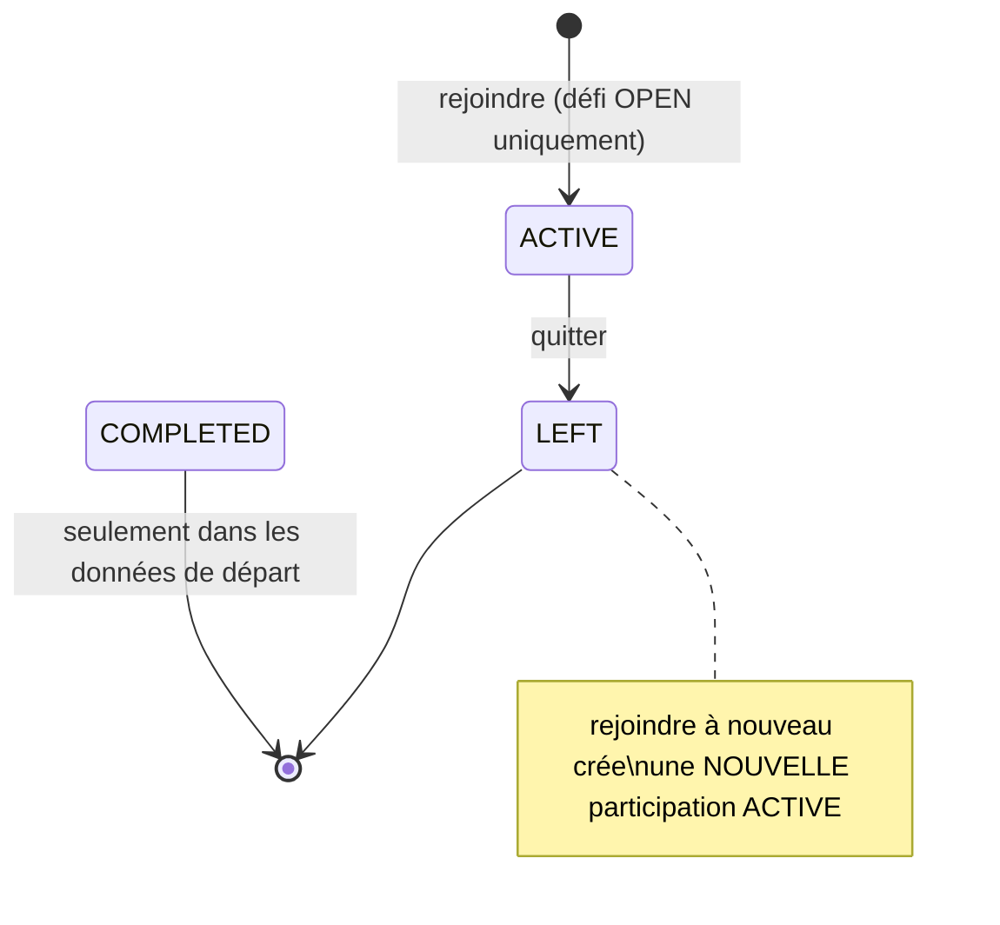

# F4 — Défis collectifs

- **Responsable** : Simon
- **User stories** : US-CHAL-01 à 05
- **Règles** : RG-CHAL-01 à 08
- **Décisions** : ADR-19, ADR-20, ADR-22

## Comportement

Une **participation** est l'inscription d'un utilisateur à un défi. Cycle de vie :

| Id | Exigence | Source |
|---|---|---|
| F4-R01 | La liste montre tous les défis : titre, catégorie, période, cible + unité, statut | ACC-CHAL-01 |
| F4-R02 | Chaque défi expose aussi la participation **de l'utilisateur de la session** (celle qui est ACTIVE, sinon la plus récente, sinon aucune) et `canJoin` | RG-CHAL-08 |
| F4-R03 | `canJoin` = défi **OPEN** **et** aucune participation ACTIVE de l'utilisateur sur ce défi | RG-CHAL-02 à 05 |
| F4-R04 | Rejoindre un défi OPEN crée une participation ACTIVE : `userId` = session, `joinedAt` = date du jour, `progressValue` = 0 | ACC-CHAL-03, 04, REC-08 |
| F4-R05 | Rejoindre un défi UPCOMING ou CLOSED → 409 `CHALLENGE_NOT_JOINABLE`, avec le message « Ce défi n'a pas encore commencé. » ou « Ce défi est terminé : il n'est plus possible de le rejoindre. » | RG-CHAL-03, 04, ACC-CHAL-06, REC-09 |
| F4-R06 | Rejoindre alors qu'une participation ACTIVE existe déjà → 409 `ALREADY_JOINED`. Garanti aussi par l'index unique en base (deux requêtes simultanées → une seule réussit) | RG-CHAL-05, ACC-CHAL-05 |
| F4-R07 | Après LEFT, rejoindre un défi OPEN crée une **nouvelle** participation ; l'ancienne reste LEFT (Alex sur chl-002 : part-006) | ADR-20 |
| F4-R08 | Quitter une participation ACTIVE la passe à LEFT. Sans participation ACTIVE → 409 `NOT_JOINED`. COMPLETED et LEFT ne peuvent pas être quittées | RG-CHAL-07, ACC-CHAL-07 |
| F4-R09 | La progression affichée est `progressValue` de la participation de l'utilisateur, en **lecture seule**. Aucune donnée d'un autre participant n'est jamais renvoyée (ni noms, ni nombre, ni classement) | RG-CHAL-08, ACC-CHAL-08, RG-PROG-04, ADR-22 |
| F4-R10 | Défi inconnu → 404 | — |
| F4-R11 | Le statut n'est **jamais** calculé à partir de la date du jour (ADR-19) | ADR-19 |

## Écrans

### `/defis` et `/defis/{challengeId}` (UX p.8)
- Titre « Défis disponibles ».
- Sous-titre « La participation est toujours volontaire. Vous pouvez quitter un défi à tout moment. »
- **Liste à gauche**, une carte par défi :
  - titre, catégorie, badge de statut (Ouvert, À venir, Terminé) ;
  - mention « Vous participez » si la participation est ACTIVE.
- Ordre : OPEN, puis UPCOMING, puis CLOSED. La carte sélectionnée porte `aria-current`.
- **Détail à droite** (le premier défi par défaut) : titre, statut, « Objectif : 10 000 pas/jour », « Période : du 1 février 2026 au 28 février 2026 », thème, description.
- **Encadré « Ma participation »** s'il existe une participation :
  - statut, « 7 800 / 10 000 pas/jour », date d'inscription, barre de progression ;
  - la mention « Seule votre progression est affichée. Aucun classement entre salariés. ».
- **Actions** :

| Situation | Action affichée |
|---|---|
| `canJoin` et jamais rejoint | Bouton « Rejoindre le défi » |
| `canJoin` après LEFT | Bouton « Rejoindre à nouveau » |
| Participation ACTIVE | Bouton « Quitter le défi » |
| UPCOMING | Information « Ce défi n'a pas encore commencé : l'inscription ouvrira à son lancement. », pas de bouton |
| CLOSED | Information « Ce défi est terminé : il n'est plus possible de le rejoindre. », pas de bouton |

- **Confirmation** : « Quitter le défi » affiche dans le panneau « Quitter ce défi ? Vous pourrez le rejoindre à nouveau tant qu'il est ouvert. » avec « Oui, quitter » et « Annuler ». « Rejoindre » ne demande pas de confirmation : c'est volontaire et réversible.

| État | Texte |
|---|---|
| Chargement | « Chargement des défis… » |
| Vide | « Aucun défi pour le moment » — « De nouveaux défis seront proposés prochainement. » |
| Rejoint | « Défi rejoint. Votre participation est visible dans votre espace. » (UX p.11 « Succès ») |
| Quitté | « Vous avez quitté le défi. » |
| Erreur (409, 503) | Message de l'API en alerte |

- **Accessibilité** :
  - les cartes de la liste sont des boutons ou des liens, utilisables au clavier ;
  - le détail est dans une région `aria-live="polite"` ;
  - le bouton est désactivé pendant l'envoi (pas de double clic) ;
  - sur mobile, le détail passe sous la liste.

## API

| Action | Endpoint | Codes |
|---|---|---|
| Lister | `GET /api/v1/me/challenges` | 200 |
| Consulter | `GET /api/v1/me/challenges/{id}` | 200, 404 |
| Rejoindre | `POST /api/v1/me/challenges/{id}/join` | 200, 404, 409 `CHALLENGE_NOT_JOINABLE` ou `ALREADY_JOINED` |
| Quitter | `POST /api/v1/me/challenges/{id}/leave` | 200, 404, 409 `NOT_JOINED` |

## Critères d'acceptation

| Critère | Exigences | Vérification | Test |
|---|---|---|---|
| ACC-CHAL-01 | R01 | Intégration | `acc_chal_01_liste_6_defis` |
| ACC-CHAL-02 | R01, écran | Intégration, E2E | `acc_chal_02_statuts_distingues` |
| ACC-CHAL-03 / REC-08 | R04 | Intégration, E2E | `acc_chal_03_rejoindre_open`, `rec_08` (chl-005) |
| ACC-CHAL-04 | R04 | Intégration | `acc_chal_04_participation_rattachee` |
| ACC-CHAL-05 | R06 | Unitaire, intégration (deux requêtes simultanées) | `acc_chal_05_pas_de_doublon_actif` (chl-001) |
| ACC-CHAL-06 / REC-09 | R05 | Unitaire, intégration, E2E | `acc_chal_06_closed_refuse`, `rec_09` (chl-004) |
| ACC-CHAL-07 | R08 | Unitaire, intégration | `acc_chal_07_quitter` |
| ACC-CHAL-08 | R09 | Intégration | `acc_chal_08_ma_progression_seule` |

## Hors périmètre

- Modification de la progression d'un défi par l'utilisateur.
- Passage automatique à COMPLETED.
- Classements, nombre de participants.
