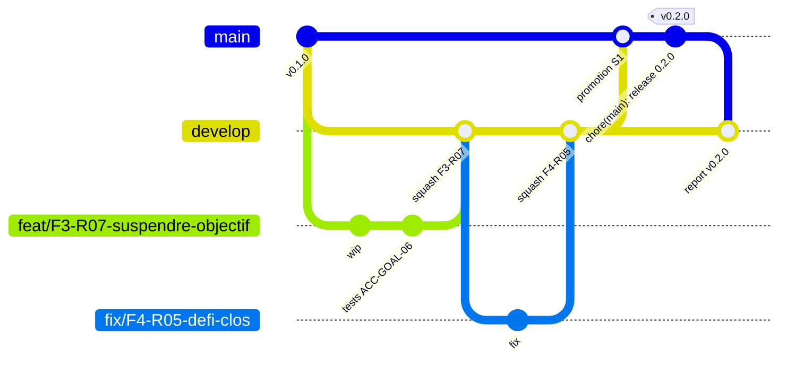

# Workflow Git, revues et Trello

Responsables : **Mael** (pilote, réglages GitHub et Trello), **Maxime** (référent qualité, CI). Répond au CDC §4.4, §5.2 (« stratégie simple de branches, commits et revues ») et §5.6 (revues de code). Le déploiement est décrit dans [ci-cd.md](ci-cd.md).

## Principe

Deux branches longues, des branches de travail courtes, et une PR relue pour toute modification. Personne ne pousse directement sur `main` ni sur `develop`, et GitHub l'interdit techniquement ([ci-cd.md](ci-cd.md) → Protection des branches).

| Branche | Rôle | Environnement Railway | Qui y écrit |
|---|---|---|---|
| `main` | **Production** : la version montrée au jury. Toujours démontrable | `production` | Uniquement par PR : promotion depuis `develop`, PR de release-please, ou hotfix |
| `develop` | **Intégration et recette** : ce qui est fini mais pas encore livré. Branche par défaut du dépôt | `staging` | Uniquement par PR depuis une branche de travail |
| `feat/…`, `fix/…`, etc. | Une carte Trello = une branche = une PR | aucun | Son auteur |



## Branches de travail

- Partent **toujours** de `develop` à jour (`git switch develop && git pull && git switch -c …`), sauf les hotfix.
- Nom : `<type>/<id-carte>-<libellé-court>` en minuscules, sans accents.

| Type | Usage | Exemple |
|---|---|---|
| `feat/` | Exigence d'une spec | `feat/F3-R07-suspendre-objectif` |
| `fix/` | Anomalie | `fix/F4-R05-defi-clos-rejoignable` |
| `spec/` | Spec seule, sans code | `spec/workflow-ci-cd-railway` |
| `test/` | Tests seuls (E2E, axe) | `test/REC-07-objectifs` |
| `ci/` | CI, Railway, outillage | `ci/job-e2e` |
| `docs/`, `chore/` | README, livrables, maintenance | `docs/L6-recette` |
| `hotfix/` | Correctif urgent en production, part de `main` | `hotfix/session-cookie-secure` |

Le préfixe de branche n'est pas vérifié par GitHub ; le **titre de PR**, si (ci-dessous).

- Durée de vie courte : **une séance**, deux au plus. Une carte qui ne tient pas en 3 h est découpée.
- Supprimée automatiquement après la fusion (réglage du dépôt).

## Commits

Convention **Angular** (la base des Conventional Commits) : `type(scope): sujet`.

| Type | Usage | Dans le changelog |
|---|---|---|
| `feat` | Nouvelle exigence d'une spec | Fonctionnalités |
| `fix` | Correction d'anomalie | Corrections |
| `perf` | Performance, sans changement de comportement | Performances |
| `refactor` | Restructuration, sans changement de comportement | masqué |
| `test` | Tests seuls | Tests |
| `docs` | Specs (`docs(spec)`), README, livrables | Specs et documentation |
| `build` | Dépendances, workspace, Makefile | masqué |
| `ci` | Workflows GitHub, Railway | masqué |
| `revert` | Annulation d'un commit | Retours arrière |
| `chore` | Réservé à release-please (`chore(main): release …`) et aux promotions (`chore(release): …`) | masqué |

- **Scope** facultatif, en minuscules : `auth`, `sim`, `session`, `prefs`, `goals`, `challenges`, `progress`, `admin`, `web`, `desktop`, `db`, `spec`, `deps`.
- **Sujet** à l'infinitif, en minuscules, sans point final, 72 caractères au plus : `suspendre un objectif`, pas `Suspension d'objectif.`
- **Rupture** : `!` après le type ou le scope, et un pied `BREAKING CHANGE:` qui explique la migration.
- Sur `develop`, chaque PR est fusionnée en **squash** : le **titre de la PR devient le commit**. C'est donc le titre qui porte la convention, vérifiée par le workflow `pr-title` :

  `feat(goals): suspendre un objectif [F3-R07]`

  `feat` et `fix` finissent **obligatoirement** par l'identifiant de spec entre crochets (`[F3-R07]`, `[F1-R07, ACC-AUTH-08]`, ou `[ADR-05]` pour le socle). Pour les autres types, c'est facultatif.
- Ces titres alimentent directement le changelog et les notes de version générés par release-please (Release ci-dessous) : un titre bâclé se voit dans la Release GitHub.
- Les commits intermédiaires de la branche sont libres mais lisibles ; ils disparaissent au squash.
- Le squash garde l'auteur de la PR comme auteur du commit : l'historique de `develop` et `main` montre qui a fait quoi (Q11.4, L3).
- Pas de ligne de co-auteur IA (ADR-26, hook `commit-msg`).

## Pull requests

**Une carte = une PR**, petite (viser moins de 400 lignes modifiées hors fichiers générés). Une PR ouverte trop tôt reste en **brouillon** (draft) tant qu'elle n'est pas prête.

Contenu attendu (modèle `.github/pull_request_template.md`) :
1. Lien vers la carte Trello.
2. Exigences couvertes (`F3-R07`) et critères testés (`ACC-GOAL-06`, `REC-07`).
3. Comment vérifier : commande, compte de démo, écran.
4. Capture pour tout changement visible.

| Cible | Méthode de fusion | Relecture | Checks requis |
|---|---|---|---|
| `develop` | **Squash** pour les branches de travail ; merge commit seulement pour un report `main` → `develop` | 1 approbation d'un autre membre | `rust`, `web`, `secrets`, `pr-title` |
| `main` | **Merge commit** uniquement (jamais squash) | 1 approbation d'un autre membre | les mêmes + `e2e` |

Pourquoi le merge commit vers `main` : un squash de `develop` vers `main` crée un commit que `develop` ne contient pas, et la PR de promotion suivante affiche alors des conflits et des différences fantômes. Le merge commit garde aussi, dans l'historique de `main`, les commits Angular de `develop` dont release-please a besoin.

### Relecture

Le relecteur vérifie, dans l'ordre (constitution 3, 4, 9, 11) :
1. La règle citée est bien celle de la spec, et la spec a été mise à jour si le comportement change.
2. Les droits sont contrôlés **côté API** (rôle, propriété de la ressource, 404/403).
3. Chaque test porte l'identifiant ACC ou REC qu'il vérifie, et la CI est verte.
4. Aucun secret, aucune donnée réelle, aucun mot de passe dans un journal.
5. L'auteur sait expliquer son code (sinon : pas de fusion).

- Une PR qui touche `session`, `auth_client`, `/admin/*` ou `/__control` est relue par le **référent sécurité** (Grégory), sauf si c'est lui l'auteur.
- Délai : une PR « En revue » est relue **dans la séance** ou au début de la suivante. Le relecteur commente, l'auteur corrige ; on ne réécrit pas le code de l'autre.
- Toute nouvelle poussée annule l'approbation : il faut relire le dernier état.
- Les conversations doivent être résolues avant la fusion. C'est l'**auteur** qui fusionne, une fois approuvé et vert.

## Release : `develop` → `main`

Une release **à la fin de chaque sprint** (S0 à S3), plus une dernière avant la soutenance. C'est la « revue de version » interne (CDC §5.6, §8). **release-please** calcule la version et écrit le changelog à partir des titres Angular ; personne ne choisit un numéro ni ne rédige de notes à la main.

1. **Promotion** : le pilote ouvre la PR `develop` → `main`, titre `chore(release): fin du sprint S1`. Conditions pour fusionner :
   - CI verte, y compris `e2e` ;
   - recette faite sur `staging` pour les cartes du sprint (colonne Trello « En recette » vide) et `traceability.md` à jour ;
   - **aucune anomalie Critique ouverte** (CDC §5.6) ;
   - migrations du sprint relues ([ci-cd.md](ci-cd.md) → Migrations).

   Fusion en merge commit. `production` se redéploie.
2. **PR de release** : release-please ouvre (ou met à jour) la PR `chore(main): release X.Y.Z`, qui ne touche que `CHANGELOG.md` et la version. On relit le changelog : c'est la liste des commits du sprint, avec leurs identifiants de spec.
3. **Publication** : à sa fusion, release-please crée le tag `vX.Y.Z` et la Release GitHub avec ces notes.
4. **Report** : PR `main` → `develop` en merge commit (`chore(release): report de vX.Y.Z`), pour que `develop` ait le changelog et la version.
5. **Vérification** de `production` : `/health` affiche le bon commit, connexion d'Alex et de Léa, un 401.

Versions attendues (release-please monte la version mineure à chaque `feat` tant qu'on est en 0.x, la version de correctif s'il n'y a que des `fix`) :

| Version | Moment |
|---|---|
| `v0.1.0` | Fin S0 : socle déployé |
| `v0.2.0` | Fin S1 : F1 à F6 |
| `v0.3.0` ou `v0.2.x` | Fin S2 : recette passée |
| `v1.0.0` | Version présentée en soutenance, forcée par `"release-as": "1.0.0"` dans `release-please-config.json` le temps de cette release |

**Gel** : à partir de J-2 avant la soutenance, `main` ne reçoit plus que des correctifs d'anomalies Critiques.

## Hotfix

Pour une anomalie Critique vue **en production** qui ne peut pas attendre la release suivante.

1. Branche `hotfix/…` depuis `main`, test qui reproduit l'anomalie, PR vers `main` (relue, CI verte).
2. release-please propose aussitôt la PR de release `v0.2.1` ; on la fusionne.
3. Tout de suite après : PR `main` → `develop` en merge commit, pour que `develop` contienne le correctif.

## Trello

Tableau : https://trello.com/b/Ed35xHmf/mspr. Il est **régénéré à partir des specs** ([organisation.md](organisation.md) → Trello) : les cartes de la V0 TypeScript (`T-xxx`) sont archivées.

### Colonnes et passages

| Colonne | Une carte y entre quand… | Qui la déplace |
|---|---|---|
| Backlog | elle existe dans une spec | pilote |
| À faire | elle est retenue pour le sprint et respecte la définition de prêt | pilote, au début du sprint |
| En cours | sa branche est créée. **2 cartes au plus par personne** | auteur |
| En revue | sa PR est ouverte (hors brouillon) et la CI est verte | auteur |
| En recette | la PR est fusionnée dans `develop` et `staging` affiche le commit | auteur |
| Terminé | un **autre membre** a vérifié la carte sur `staging` et `traceability.md` est à jour | celui qui a vérifié |

- Une carte refusée en recette revient en « En cours », avec un commentaire qui dit ce qui ne va pas.
- Les cartes « Terminé » partent en production à la release du sprint ; elles restent visibles avec leur étiquette de sprint (trace pour le jury).
- Le Power-Up **GitHub** de Trello rattache la branche et la PR à la carte.

### Format d'une carte

- **Titre** : `F3-R07 – Suspendre un objectif` (exigence), `BUG – <symptôme>` (anomalie), `TECH – <sujet>` (socle, CI, Railway).
- **Membre** : une seule personne, celle qui porte la carte.
- **Étiquettes** : sprint (S0 à S3), fonctionnalité (Socle, F1 à F6), priorité **MoSCoW**, et si besoin « Anomalie », « Critique ».
- **Description** :

```
Spec : spec/features/F3-objectifs.md (F3-R07)
Critères : ACC-GOAL-06, REC-07
Estimation : 1 h 30
Dépend de : extracteur CurrentUser (F1)
Branche / PR : (rattachées par le Power-Up)
```

### Priorité MoSCoW

Chaque carte porte une et une seule étiquette de priorité, reprise de HAC-BACKLOG-001 quand elle y figure :

| Étiquette | Sens pour PULSE V1 | Exemples |
|---|---|---|
| **MUST** | Exigé pour la revue de version : on ne le coupe jamais | F1 à F6, simulateur conforme, contrôles de droits, CI de base |
| **SHOULD** | Attendu si la capacité le permet (CDC « besoin secondaire ») | Contenus admin (F6) |
| **COULD** | Bonus, seulement après F1 à F6 validées en recette (CDC §6) | App Tauri, critères AAA, E2E WebKit |
| **WON'T** | Écarté **pour V1**, gardé visible pour L7 (recommandations V2 et V3) | MongoDB, conteneurisation, pipeline CI/CD complet, environnements de PR |

- Les cartes WON'T restent dans « Backlog » : elles montrent au jury ce qu'on a choisi de ne pas faire, et pourquoi.
- L'ordre de sacrifice d'[organisation.md](organisation.md) → Priorités s'applique de COULD vers SHOULD, jamais aux MUST.

### Définition de prêt (avant « À faire »)

- L'exigence existe dans une spec fusionnée dans `develop`.
- Les critères ACC ou REC à tester sont identifiés.
- Les dépendances sont connues et prêtes (ou simulables).
- Elle est **estimée** (en heures) et tient en 3 h ; sinon on la découpe. Estimations et dépendances sont exigées pour le backlog opérationnel (HAC-BACKLOG-001, onglet « Lisez-moi »).

### Définition de fini (avant « Terminé »)

- Code et tests fusionnés dans `develop` par une PR approuvée, CI verte.
- Chaque test porte l'identifiant du critère qu'il vérifie.
- Vérifiée sur `staging` par un autre membre que l'auteur.
- `traceability.md` mis à jour dans la PR ; spec et README à jour si le comportement a changé.
- Aucune nouvelle violation axe sur les écrans touchés.

### Anomalies

1. Carte `BUG – …` avec l'étiquette « Anomalie », et « **Critique** » si elle bloque un scénario REC ou viole CDC §4.1 ou §4.5 ([testing.md](testing.md) → Anomalies).
2. La description précise : environnement (local, `staging`, `production`), étapes, résultat attendu et obtenu, REC ou ACC touchés, commit vu dans `/health`.
3. Correction sur `fix/…` avec un test qui reproduit l'anomalie. Une anomalie Critique passe en tête de « À faire » et **bloque la release**.
4. Chaque anomalie est reportée dans `docs/recette.md` (L6), corrigée ou non.
