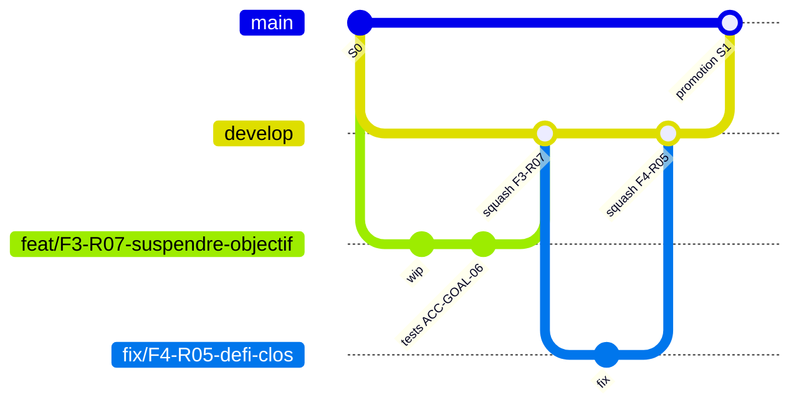

# Workflow Git et revues

Responsables : **Mael** (pilote, réglages GitHub), **Maxime** (référent qualité). Répond au CDC §4.4, §5.2 (« stratégie simple de branches, commits et revues ») et §5.6 (revues de code). Décision : ADR-28. Les vérifications automatiques et les rulesets sont dans [ci.md](ci.md).

## Principe

Deux branches longues, des branches de travail courtes, et une PR relue pour toute modification. Personne ne pousse directement sur `main` ni sur `develop`, et GitHub l'interdit techniquement ([ci.md](ci.md) → Protection des branches).

| Branche | Rôle | Qui y écrit |
|---|---|---|
| `main` | **Version livrée** : celle montrée au jury. Toujours démontrable | Uniquement par PR : promotion depuis `develop`, ou hotfix |
| `develop` | **Intégration** : ce qui est fini mais pas encore livré. Branche par défaut du dépôt | Uniquement par PR depuis une branche de travail |
| `feat/…`, `fix/…`, etc. | Une carte Trello = une branche = une PR | Son auteur |

## Branches de travail

- Partent **toujours** de `develop` à jour (`git switch develop && git pull && git switch -c …`), sauf les hotfix.
- Nom : `<type>/<id-carte>-<libellé-court>` en minuscules, sans accents.

| Type | Usage | Exemple |
|---|---|---|
| `feat/` | Exigence d'une spec | `feat/F3-R07-suspendre-objectif` |
| `fix/` | Anomalie | `fix/F4-R05-defi-clos-rejoignable` |
| `spec/` | Spec seule, sans code | `spec/workflow-git` |
| `test/` | Tests seuls (E2E, axe) | `test/REC-07-objectifs` |
| `ci/` | CI, hébergement, outillage | `ci/job-rust` |
| `docs/` | README, livrables | `docs/L6-recette` |
| `hotfix/` | Correctif urgent sur la version livrée, part de `main` | `hotfix/session-cookie-secure` |

Le préfixe de branche n'est pas vérifié par GitHub ; le **titre de PR**, si (ci-dessous).

- Durée de vie courte : **une séance**, deux au plus. Une carte qui ne tient pas en 3 h est découpée.
- Supprimée automatiquement après la fusion (réglage du dépôt).

## Commits

Convention **Angular** (la base des Conventional Commits) : `type(scope): sujet` (ADR-34).

| Type | Usage |
|---|---|
| `feat` | Nouvelle exigence d'une spec |
| `fix` | Correction d'anomalie |
| `perf` | Performance, sans changement de comportement |
| `refactor` | Restructuration, sans changement de comportement |
| `test` | Tests seuls |
| `docs` | Specs (`docs(spec)`), README, livrables |
| `build` | Dépendances, workspace, Makefile |
| `ci` | Workflows GitHub, hébergement |
| `revert` | Annulation d'un commit |
| `chore` | Promotions `develop` → `main` (`chore(release): fin du sprint S1`) |

- **Scope** facultatif, en minuscules : `auth`, `sim`, `session`, `prefs`, `goals`, `challenges`, `progress`, `admin`, `web`, `desktop`, `db`, `spec`, `deps`.
- **Sujet** à l'infinitif, en minuscules, sans point final, 72 caractères au plus : `suspendre un objectif`, pas `Suspension d'objectif.`
- **Rupture** : `!` après le type ou le scope, et un pied `BREAKING CHANGE:` qui explique la migration.
- Sur `develop`, chaque PR est fusionnée en **squash** : le **titre de la PR devient le commit**. C'est donc le titre qui porte la convention, vérifiée par le workflow `pr-title` :

  `feat(goals): suspendre un objectif [F3-R07]`

  `feat` et `fix` finissent **obligatoirement** par l'identifiant de spec entre crochets (`[F3-R07]`, `[F1-R07, ACC-AUTH-08]`, ou `[ADR-05]` pour le socle). Pour les autres types, c'est facultatif.
- Les commits intermédiaires de la branche sont libres mais lisibles ; ils disparaissent au squash.
- Le squash garde l'auteur de la PR comme auteur du commit : l'historique montre qui a fait quoi (Q11.4, L3).
- Pas de ligne de co-auteur IA (ADR-26, hook `commit-msg`, à activer une fois par clone : `git config core.hooksPath .githooks`).

## Pull requests

**Une carte = une PR**, petite (viser moins de 400 lignes modifiées hors fichiers générés). Une PR ouverte trop tôt reste en **brouillon** (draft) tant qu'elle n'est pas prête.

Contenu attendu (modèle `.github/pull_request_template.md`) :
1. Lien vers la carte Trello.
2. Exigences couvertes (`F3-R07`) et critères testés (`ACC-GOAL-06`, `REC-07`).
3. Comment vérifier : commande, compte de démo, écran.
4. Capture pour tout changement visible.

| Cible | Méthode de fusion | Relecture |
|---|---|---|
| `develop` | **Squash** ; merge commit seulement pour un report `main` → `develop` après un hotfix | 1 approbation d'un autre membre, CI verte |
| `main` | **Merge commit** uniquement (jamais squash) | 1 approbation d'un autre membre, CI verte |

Pourquoi le merge commit vers `main` : un squash de `develop` vers `main` crée un commit que `develop` ne contient pas, et la PR de promotion suivante affiche alors des conflits et des différences fantômes.

### Relecture

Le relecteur vérifie, dans l'ordre (constitution 3, 4, 9, 11) :
1. La règle citée est bien celle de la spec, et la spec a été mise à jour si le comportement change.
2. Les droits sont contrôlés **côté API** (rôle, propriété de la ressource, 404/403).
3. Chaque test porte l'identifiant ACC ou REC qu'il vérifie, et la CI est verte.
4. Aucun secret, aucune donnée réelle, aucun mot de passe dans un journal.
5. L'auteur sait expliquer son code (sinon : pas de fusion).

- Une PR qui touche `session`, `auth_client`, `/admin/*` ou `/__control` est relue par le **référent sécurité** (Grégory), sauf si c'est lui l'auteur.
- Délai : une PR « En revue » est relue **dans la séance** ou au début de la suivante. Le relecteur commente, l'auteur corrige ; on ne réécrit pas le code de l'autre.
- Toute nouvelle poussée annule l'approbation : il faut relire le dernier état.
- Les conversations doivent être résolues avant la fusion. C'est l'**auteur** qui fusionne, une fois approuvé et vert.

## Promotion : `develop` → `main`

Une promotion **à la fin de chaque sprint** (S0 à S3) : c'est la « revue de version » interne (CDC §5.6, §8).

1. Le pilote ouvre la PR `develop` → `main`, titre `chore(release): fin du sprint S1`. Conditions pour fusionner :
   - CI verte ;
   - démo interne faite et `traceability.md` à jour ;
   - **aucune anomalie Critique ouverte** (CDC §5.6).
2. Fusion en merge commit.

**Gel** : à partir de J-2 avant la soutenance, `main` ne reçoit plus que des correctifs d'anomalies Critiques.

## Hotfix

Pour une anomalie Critique vue sur la version livrée qui ne peut pas attendre la promotion suivante.

1. Branche `hotfix/…` depuis `main`, test qui reproduit l'anomalie, PR vers `main` (relue, CI verte).
2. Tout de suite après : PR `main` → `develop` en merge commit, pour que `develop` contienne le correctif.
